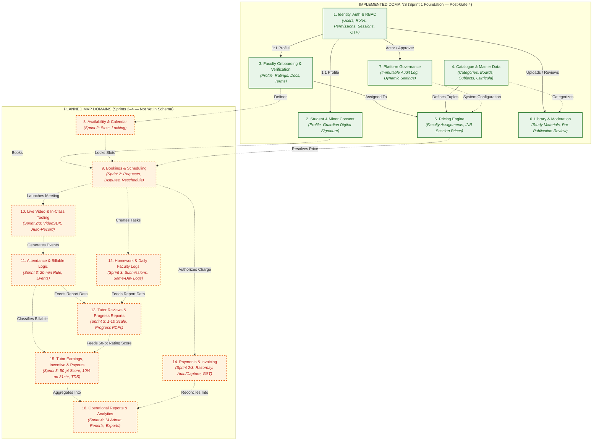
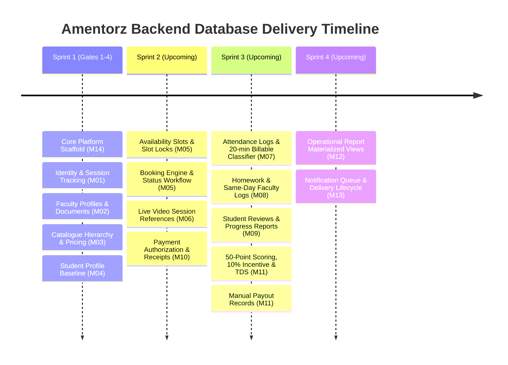

# Amentorz — High-Level Domain Architecture & Relationship Overview

> **Revision 27 October 2026 (student onboarding UI alignment):** the student and consent sections below describe the Gate 4 baseline and are partly superseded. Migration `20261027090000_student_onboarding` replaced `users.first_name`/`last_name` with `full_name`, added `mobile_number` and `timezone`, rebuilt `student_profiles` (no `is_under_18` or consent columns), and added `student_subjects`, `teaching_languages`, `policy_documents`, `policy_acceptances` and `guardian_consents` (33 models, 11 enums). The contract adds registration email OTP, policy and guardian-consent endpoints and a rewritten `POST /auth/register` (76 paths, 88 operations). Current reference: [`schema-data-dictionary.md`](schema-data-dictionary.md) v1.1 and `docs/openapi.yaml`.

**Document Version:** 1.0  
**Date:** October 23, 2026  
**Audience:** Technical Management, Product Owners, Engineering Leads  
**Purpose:** Executive, conceptual overview of platform domains, foreign-key relationships, and roadmap boundaries.

---

## 1. Executive Domain Architecture

The Amentorz learning platform is architectured as a **Modular Monolith** over a single PostgreSQL database, providing unified data models for three primary web portals:
1. **Student Portal**
2. **Faculty / Tutor Portal**
3. **Platform Administrator Portal**

The database design establishes clean domain boundaries that isolate operational concerns while maintaining relational integrity.

---

## 2. Implemented Domain Relationships (Current Database State)

The table below delineates the concrete **Foreign-Key Relationships** versus **Conceptual Associations** currently enforced in the PostgreSQL database.

| Source Domain | Target Domain | Relationship Type | Enforced Foreign Key | Business Meaning |
|---|---|:---:|---|---|
| **Identity & RBAC** | **Student Domain** | 1 : 0..1 | `student_profiles.user_id → users.id` (CASCADE) | Exactly one student profile per student identity. Deleting user cascades profile. |
| **Identity & RBAC** | **Faculty Domain** | 1 : 0..1 | `faculty_profiles.user_id → users.id` (CASCADE) | Exactly one tutor profile per faculty identity. |
| **Identity & RBAC** | **Faculty Domain** | 1 : N | `faculty_profiles.approved_by → users.id` (SET NULL) | Administrator attribution for tutor profile onboarding and approval. |
| **Identity & RBAC** | **Faculty Domain** | 1 : N | `faculty_documents.verified_by → users.id` (SET NULL) | Administrator attribution for background check and document verification. |
| **Faculty Domain** | **Catalogue & Pricing**| 1 : N | `faculty_assignments.faculty_id → faculty_profiles.id` (CASCADE) | Connects approved tutor to teaching assignments. |
| **Catalogue & Pricing**| **Catalogue Hierarchy**| N : 1 | `curricula.{category_id, board_id, subject_id, level_id}` (RESTRICT) | Restricts deletion of master educational tiers if curricula are active. |
| **Catalogue & Pricing**| **Pricing Engine** | N : 1 | `price_rules.curriculum_id → curricula.id`, optional `price_rules.faculty_id → faculty_profiles.id` (RESTRICT) | Default price per offering plus optional tutor prices; one active rule per offering and tutor per period (ADR 0004). |
| **Identity & RBAC** | **Library Domain** | 1 : N | `library_materials.uploaded_by → users.id` (RESTRICT) | Identifies study material author/uploader. |
| **Catalogue** | **Library Domain** | 1 : N | `library_materials.curriculum_id → curricula.id` (SET NULL) | Associates study materials with optional educational curriculum. |
| **Identity & RBAC** | **Library Domain** | 1 : N | `library_reviews.reviewer_id → users.id` (RESTRICT) | Administrative moderation attribution before material publication. |
| **Platform Governance**| **Identity & RBAC** | 1 : N | `audit_logs.actor_id → users.id` (SET NULL) | Immutable cryptographic audit ledger linking actions to authenticated actors. |
| **Platform Governance**| **Identity & RBAC** | 1 : N | `system_settings.updated_by → users.id` (SET NULL) | Tracks administrator who modified platform runtime configuration. |

---

## 3. Boundary Distinctions & Client Scope Rules

The implemented schema strictly enforces the contractual boundaries agreed in the **Software Development Agreement (Annexure 1 SOW v2.0)**:

### 3.1 Single Identity Model Across Three Portals
- **Contractual Rule:** One shared backend and single database serve all portals.
- **Implementation:** Table `users` serves as the global identity anchor. Roles (`student`, `faculty`, `admin`) govern portal authorization. Refresh tokens track `portal` origin and `family_id` to prevent cross-portal token substitution.

### 3.2 No Parent Profiles / Accounts in Phase 1
- **Contractual Rule:** Section A1.1 & A1.3 explicitly excludes parent accounts and parent dashboards. Minor student details are captured strictly on the student profile.
- **Implementation:** `student_profiles` stores `guardian_name`, `guardian_email`, `guardian_phone`, `is_under_18`, `guardian_consent_signed`, and `guardian_consent_signed_at`. No separate parent user or parent portal table exists.

### 3.3 Single-Session INR Pricing (No Packages)
- **Contractual Rule:** M03 confirmed rule: prepaid packages and bundles are deferred from Phase 1. Pricing is single-session only, strictly denominated in INR.
- **Implementation:** `price_rules` stores `session_price_paise` (integer paise, e.g. 75000 = ₹750.00) with server-computed `gst_paise` and `student_pays_paise`; currency INR and 60-minute sessions are fixed (ADR 0004). No package, credit-pack, or subscription tables exist.

### 3.4 Tutor Incentive Model (50-Point / 30-Session Threshold)
- **Contractual Rule:** Annexure 1 Section A1.7.9 replaced the old 10-parameter model with a five-parameter, 50-point score (30 sessions, 40 points, 10% on sessions from the 31st onward).
- **Implementation:** `faculty_profiles` carries `ratings_average` (`Decimal(3, 2)`) and `ratings_count` (`Int`) to feed the upcoming Sprint 3 incentive calculation engine.

---

## 4. Roadmap Dependencies & Planned MVP Expansions

To deliver the remaining 9 functional modules scheduled across Sprints 2–4, the database schema will require progressive additions in subsequent gates:

### Next Implementation Target (Sprint 2 Database Gate):
The immediate technical prerequisite before starting Sprint 2 application development is the addition of:
1. `tutor_availabilities` / `availability_slots`
2. `booking_slot_locks`
3. `bookings`
4. `payments` / `payment_transactions`
5. `video_sessions`
