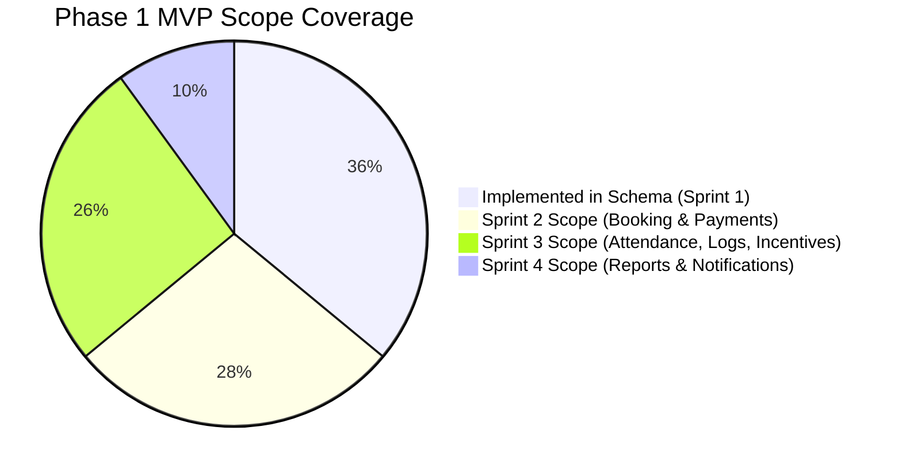

# Amentorz Backend — Manager Database Review Summary

> **Revision 27 October 2026 (student onboarding UI alignment):** the student and consent sections below describe the Gate 4 baseline and are partly superseded. Migration `20261027090000_student_onboarding` replaced `users.first_name`/`last_name` with `full_name`, added `mobile_number` and `timezone`, rebuilt `student_profiles` (no `is_under_18` or consent columns), and added `student_subjects`, `teaching_languages`, `policy_documents`, `policy_acceptances` and `guardian_consents` (33 models, 11 enums). The contract adds registration email OTP, policy and guardian-consent endpoints and a rewritten `POST /auth/register` (76 paths, 88 operations). Current reference: [`schema-data-dictionary.md`](schema-data-dictionary.md) v1.1 and `docs/openapi.yaml`.

**Document Reference:** `AMZ-MGR-SUM-004`  
**Date:** October 23, 2026  
**Audience:** Engineering Manager, Technical Product Owner, Pod Lead, Stakeholders  
**Review Status:** Read-Only Assessment & Manager Review Package (Awaiting Formal Sign-Off)

---

## 1. Executive Briefing: Where Does the Database Stand?

Following the completion of **Gate 4**, the Amentorz database is in a healthy, verified state for its **Sprint 1 Foundation**. 

### The Key Takeaway
- **Current Deployed State:** 28 models and 8 enums deployed on PostgreSQL 16, fully synchronized with 2 forward migrations, backed by 72 unit tests and 71 integration tests passing at 100%.
- **Sprint 1 Foundation Status:** **100% Complete & Production-Ready.**
- **Full Phase 1 MVP Status:** **Sprint 1 Complete; Sprints 2–4 Schema Extensions Required.** The database currently covers **5 of the 14 functional modules** in the signed SOW v2.0. The remaining 9 modules (Bookings, Live Video, Attendance, Homework, Reviews, Payments, Incentives, Payouts, Advanced Reports) are scheduled for Sprints 2–4 and do not yet have tables in the database.

---

## 2. Deliverables Index

All technical artifacts generated during this verification review are indexed below:

| Deliverable | File Location | Target Audience | Summary |
| **Database Schema vs. API Contract Verification** | [`docs/database/schema-api-contract-verification.md`](file:///Users/evalogical/Projects/Evalogical/amentorz%20main/amentorz-backend/docs/database/schema-api-contract-verification.md) | Database Architect, Backend Engineers | Complete 76-operation traceability matrix, DTO field mappings, and schema-to-contract analysis. |
| **High-Level Domain Overview** | [`docs/database/amentorz-domain-overview.md`](file:///Users/evalogical/Projects/Evalogical/amentorz%20main/amentorz-backend/docs/database/amentorz-domain-overview.md) | Managers, Stakeholders | Conceptual architecture, domain boundaries, foreign-key relationships vs roadmap. |
| **Schema Data Dictionary** | [`docs/database/schema-data-dictionary.md`](file:///Users/evalogical/Projects/Evalogical/amentorz%20main/amentorz-backend/docs/database/schema-data-dictionary.md) | Developers, QA Engineers | Granular table-by-table reference covering all 28 tables, fields, constraints, and defaults. |
| **Verification & Gap Analysis Report** | [`docs/database/schema-verification-report.md`](file:///Users/evalogical/Projects/Evalogical/amentorz%20main/amentorz-backend/docs/database/schema-verification-report.md) | Staff Engineers, Leads | 14-module traceability matrix, gap classifications, business rule enforcement review. |
| **Manager Review Summary** | [`docs/database/schema-review-summary.md`](file:///Users/evalogical/Projects/Evalogical/amentorz%20main/amentorz-backend/docs/database/schema-review-summary.md) | Engineering Management | This executive briefing, decision register, checklist, and go/no-go recommendations. |
| **Visual ERD (Database Client)** | Live in **DBeaver** (`localhost:5432/amentorz_dev`) | Database Architect, Developers | Interactive visual ERD generated directly from the live PostgreSQL database schema. |

---

## 3. Major Architecture Decisions Implemented in Gate 4

1. **Modular Monolith over Single PostgreSQL Database:**
   - Single backend and single database serve Student, Faculty, and Admin portals. No microservice fragmentation in Phase 1.
2. **PostgreSQL 16 Null-Safe Uniqueness:**
   - Deployed `UNIQUE NULLS NOT DISTINCT` on `curricula([category_id, board_id, subject_id, level_id])`. Guarantees non-School curricula (where `board_id` is null) cannot have duplicate tuples.
3. **Single-Currency Financial Invariant:**
   - Monies are stored strictly as integers in paise (`price_paise`) with currency locked to `INR`. Subscriptions are out of scope (SOW A1.9). Packages are deferred per the draft project plan (M03), although SOW A1.7.2 allows them where applicable; client confirmation is pending (`docs/PENDING_DECISIONS.md`).
4. **Minor Digital Consent Tracking (No Parent Accounts):**
   - In accordance with client scope exclusions, no parent portal or parent accounts exist. Instead, minor consent audit fields (`guardian_consent_signed`, `guardian_consent_document`, `guardian_consent_signed_at`) are captured directly on `student_profiles`.
5. **Private Document Quarantine & Virus Scanning:**
   - Tutor verification files and library materials carry private storage keys and `DocumentScanStatus` (`PENDING`, `CLEAN`, `INFECTED`, `FAILED`). Files remain inaccessible to consumers until marked clean.

---

## 4. Confirmed Schema Gaps (By Delivery Sprint)

The following tables are documented in the Phase 1 SOW v2.0 but are **not yet present in the database**:

### Sprint 2 Scope (Immediate Next Gate)
- **`AvailabilitySlot` & `BookingSlotLock` (M05):** Tutor availability slots and real-time locking to prevent concurrent double-booking.
- **`Booking` (M05):** Core booking transaction with status lifecycle (`REQUESTED`, `CONFIRMED`, `REJECTED`, `CANCELLED`, `COMPLETED`, `DISPUTED`).
- **`PaymentTransaction` & `Invoice` (M10):** Gateway order, payment, capture, refund records, and GST amounts in paise. The gateway is not chosen yet: Razorpay is the leading candidate and the draft project plan names Stripe and Checkout.com as fallbacks.
- **`VideoSession` (M06):** VideoSDK meeting/room references, participant controls, and recording URLs.

### Sprint 3 Scope
- **`SessionAttendance` & `AttendanceEvent` (M07):** Join/leave duration logs and the **20-minute billable rule** (>20 min billable, ≤20 min non-billable, SOW A1.7.6). The draft project plan instead charges the student for every booked session and applies the rule to tutor payout, measured from the scheduled start; the conflict is pending (`docs/PENDING_DECISIONS.md`).
- **`Homework` & `HomeworkSubmission` (M08):** Assignment distribution, student submissions, and grading.
- **`DailySessionLog` (M08):** Tutor daily log enforcing the **same-day log next-day booking access rule**.
- **`TutorReview` & `StudentProgressReport` (M09):** Student 1–10 star ratings with moderation queue, and periodic student progress reports with PDF generation.
- **`TutorMonthlyScore`, `TutorEarnings` & `TutorPayout` (M11):** 50-point monthly score, 30-session/40-point incentive calculation (10% bonus on 31st+), TDS deductions, and manual payout tracking.

### Sprint 4 Scope
- **`NotificationQueue` / Enhanced `Notification` (M13):** User FKs, delivery channels (email, in-app), retry counters, and read/unread state for in-app notifications (not messaging read receipts, which the SOW excludes).
- **Materialized Views for Reporting (M12):** Pre-aggregated indexes for the 14 admin revenue, tutor, and tax reports.

---

## 5. Unresolved Business Decisions Requiring Product Owner Confirmation

Before the Sprint 2 and Sprint 3 database models are implemented, the following 5 client decisions (flagged in Section 3.1 & A1.7.9 of the Software Development Agreement) must be resolved:

| # | Open Item | Document Citation | Business Impact & Options |
|---|---|---|---|
| **1** | **Incentive Penalty Floor** | SOW A1.7.9 | When penalties exceed 10 points (e.g. 3 late logins × 5 pts = 15 pts deduction), does parameter score floor at 0, or carry negative points into the 50-point total? |
| **2** | **Late-Login Grace Period** | SOW A1.7.9 | Exact grace window (e.g. 3 mins, 5 mins past scheduled start) before a tutor login is classified as "Late Login" (-5 pts). |
| **3** | **Uninformed Cancellation Window** | SOW A1.7.9 | Notice window (e.g. 12h, 24h) and whether a verified medical/emergency reason exempts tutor from the 5-point cancellation penalty. |
| **4** | **30-Session Threshold Eligibility** | SOW A1.7.9 | Does the 30-session threshold count billable sessions only (>20 mins), or include student no-shows? |
| **5** | **TDS on Tutor Incentive** | SOW A1.7.9 | Is the 10% volume incentive treated as professional fees subject to standard TDS deduction alongside base earnings? |

---

## 6. Review Checklist & Recommendation

### 6.1 Review Checklist

- [x] All 28 actual Prisma models verified against PostgreSQL physical tables.
- [x] All 8 enums verified against database types.
- [x] Zero credential leaks in logs, error handlers, and test guards.
- [x] Host client databases (`anybpo_crm1`, `impacthub`) verified untouched.
- [x] Test database safety guard (`assertTestDatabaseUrl`) verified and passing.
- [x] 72 unit tests passing (100%).
- [x] 71 integration tests passing (100%) against `amentorz_test`.
- [x] Production build (`tsc && node scripts/resolve-build-aliases.cjs`) passing cleanly.
- [ ] Manager approval of Sprint 1 Database Baseline.
- [ ] Product Owner resolution of Section 5 open decisions.
- [ ] Authorization to begin Sprint 2 Schema Design (`Booking`, `Availability`, `PaymentTransaction`, `VideoSession`).

### 6.2 Recommendation on Proceeding

**Verdict:** 
1. **Approve Sprint 1 Baseline:** The current Gate 4 database schema is approved for Sprint 1 feature development (Authentication routes, Faculty profile services, Catalogue APIs, Pricing endpoints, and Library workflows).
2. **Do Not Start Sprint 2 Coding Without Sprint 2 Schema Migration:** Sprint 2 application endpoints cannot be built on top of the current schema alone. A dedicated **Sprint 2 Database Increment** must be authored and migrated before Sprint 2 feature work begins.
