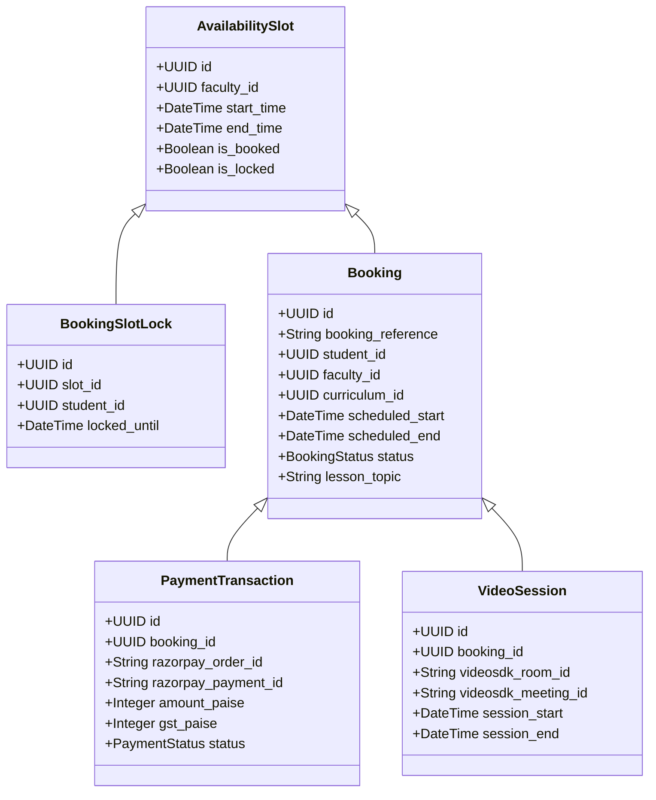

# Amentorz Backend — Post-Gate 4 Schema Verification & Gap Analysis Report

> **Revision 27 October 2026 (student onboarding UI alignment):** the student and consent sections below describe the Gate 4 baseline and are partly superseded. Migration `20261027090000_student_onboarding` replaced `users.first_name`/`last_name` with `full_name`, added `mobile_number` and `timezone`, rebuilt `student_profiles` (no `is_under_18` or consent columns), and added `student_subjects`, `teaching_languages`, `policy_documents`, `policy_acceptances` and `guardian_consents` (33 models, 11 enums). The contract adds registration email OTP, policy and guardian-consent endpoints and a rewritten `POST /auth/register` (76 paths, 88 operations). Current reference: [`schema-data-dictionary.md`](schema-data-dictionary.md) v1.1 and `docs/openapi.yaml`.

**Document Reference:** `AMZ-ENG-SEC-004`  
**Date:** October 23, 2026  
**Audience:** Staff Software Engineer, Engineering Lead, Database Architect, Product Centaur  
**Status:** Strictly Read-Only Audit & Verification Report  
**Implementation Source:** `prisma/schema.prisma`, `prisma/migrations/*`  
**Governing Documents:**
- `project-plan-v2 1.docx` (Amentorz Phase 1 Project Management Plan v2.0, Centaur Operating Model)
- `Amentorz_Evalogical_Software_Development_Agreement.pdf` (Annexure 1 SOW v2.0, September 2026)

---

## 1. Executive Summary

### 1.1 Overall Assessment
Gate 4 marked the successful completion of the **Sprint 1 Database Baseline** for the Amentorz platform. The implemented schema provides an enterprise-grade foundation for authentication, role-based access control, cryptographic auditing, student minor consent, tutor onboarding/verification, hierarchical educational catalogue structuring, and single-session pricing.

However, against the complete **14-module Phase 1 MVP Scope** defined in the governing **Software Development Agreement (SOW v2.0)** and **Project Management Plan (v2)**, the current database represents **5 of the 14 modules (Sprint 1 Foundation)**. 

### 1.2 Key Audit Verdict
- **Sprint 1 Readiness:** **100% Complete & Verified.** The schema fully supports Sprint 1 deliverables: admin faculty creation, student registration with email OTP verification, tutor profile/document ingestion, catalogue setup, and single-session price configuration.
- **Full Phase 1 MVP Readiness:** **Incomplete (By Design — Sprint Phased).** The schema currently contains **0 models** for:
  1. Availability & Slot Locking (Module M05)
  2. Booking Engine & Lifecycle (Module M05)
  3. VideoSDK Live Class Sessions & Recordings (Module M06)
  4. Attendance & 20-minute Billable Classification (Module M07)
  5. Homework Creation & Submissions (Module M08)
  6. Daily Faculty Logs & Same-Day Next-Day Access Enforcement (Module M08)
  7. Student Reviews & Progress Reports (Module M09)
  8. Payment Transactions, Invoicing, Refunds & Razorpay Webhooks (Module M10)
  9. Monthly Tutor Scoring (50 points), 10% Incentive Engine, TDS & Manual Payouts (Module M11)

### 1.3 Major Strengths
1. **P0 Database Safety & Isolation:** The test suite operates under a strict WHATWG URL safety guard (`assertTestDatabaseUrl`), completely isolating test executions to `amentorz_test` and guaranteeing client databases on the same host (`anybpo_crm1`, `impacthub`) remain untouched.
2. **PostgreSQL 16 Advanced Constraints:** Deployed `CREATE UNIQUE INDEX ... NULLS NOT DISTINCT` on `curricula([category_id, board_id, subject_id, level_id])`, permanently solving the SQL-92 nullable unique index loophole for non-School curricula where `board_id` is null.
3. **Financial Precision:** Currency is hardcoded to single-currency `INR` and monetary values are strictly represented as integers in paise (`price_paise`), eliminating IEEE-754 floating point rounding corruption.
4. **Child Safety Compliance:** Implemented digital guardian consent tracking (`is_under_18`, `guardian_consent_signed`, `guardian_consent_document`, `guardian_consent_signed_at`) without violating the client's explicit exclusion of parent accounts.

### 1.4 Primary Implementation Blockers for Sprint 2
Sprint 2 development (Discovery, Booking, Live Session, and Payments) cannot commence in application code until **Sprint 2 database models** (`AvailabilitySlot`, `BookingSlotLock`, `Booking`, `PaymentTransaction`, `VideoSession`) are drafted, reviewed, migrated, and verified.

---

## 2. Schema Inventory

| Metric | Implemented Count | Details |
|---|:---:|---|
| **Prisma Models** | **28** | Formally mapped to snake_case PostgreSQL tables |
| **Prisma Enums** | **8** | Strongly-typed PostgreSQL ENUM types |
| **Unique Constraints** | **23** | Enforcing natural keys, email uniqueness, slugs, and composite tuples |
| **Foreign Keys** | **22** | Relational integrity with explicit `CASCADE`, `RESTRICT`, and `SET NULL` actions |
| **Composite Indexes** | **12** | Optimized for frequent search, lookup, and moderation filters |
| **Migration History** | **2** | `20261022124856_init_core_security`, `20261022125538_add_amentorz_domain` |
| **Migration Parity** | **100% In Sync** | Verified across both `amentorz_dev` and `amentorz_test` |

---

## 3. Requirement-to-Schema Traceability Matrix

This matrix evaluates the actual database implementation against the 14 functional modules defined in **Section 4 of `project-plan-v2 1.docx`** and **Section A1.7 of Annexure 1 (SOW v2.0)**.

### Classification Legend
- **Implemented:** Adequately represented and enforced in the database.
- **Partially Implemented:** Existing structures cover only part of the requirement.
- **Required & Missing:** Documented MVP requirement with no database models.
- **Recommended Technical Improvement:** Architectural improvement not explicitly mandated.
- **Requires Business Decision:** Blocked by an unresolved open item.
- **Future Scope:** Explicitly excluded from Phase 1 MVP by SOW v2.0.

| Module | Requirement & Scope | Existing Schema Entity | Status | Evidence & Verification Findings | Gap / Recommended Action |
|---|---|---|:---:|---|---|
| **M14** | **Platform & Delivery** Scaffold, single DB, RBAC, audit log, system settings, feature flags. | `User`, `Role`, `Permission`, `UserRole`, `RolePermission`, `AuditLog`, `SystemSetting`, `FeatureFlag` | **Implemented** | 8 models. RBAC with hierarchy (`parent_id`), cryptographic hash-chained audit logging, dynamic JSONB runtime settings. | Maintain existing models. |
| **M01** | **Identity & Access** Separate portal access, student registration, email OTP verification, password recovery, session family tracking. | `User`, `RefreshToken`, `EmailChallenge`, `PasswordResetGrant` | **Implemented** | `users` carries `status`, `security_version`, `email_verified_at`. `refresh_tokens` enforces family tracking and rotation. `email_challenges` stores SHA-256 OTP hashes. | None for Sprint 1. |
| **M02** | **Faculty Onboarding & Profiles** Admin-only onboarding, qualifications, experience, document verification, terms acceptance on first login, admin approval. | `FacultyProfile`, `FacultyQualification`, `FacultyExperience`, `FacultyDocument`, `FacultyTerms`, `FacultyTermsAcceptance` | **Implemented** | 6 models. `FacultyApprovalStatus` enum, private document quarantine status (`DocumentScanStatus`), immutable terms versions with acceptance audit records. | Ready for Sprint 1 demo. |
| **M03** | **Catalogue, Pricing & Library** 4 category tabs (School, University, JEE/NEET, Skill), master boards/subjects/levels, curriculum tuples, single-session INR pricing, free study library with admin moderation. | `Category`, `Board`, `Subject`, `Level`, `Curriculum`, `FacultyAssignment`, `SessionPrice`, `LibraryMaterial`, `LibraryReview` | **Implemented** | 9 models. `curricula` tuple uniqueness enforced with PostgreSQL 16 `NULLS NOT DISTINCT`. `session_prices` stores integer paise (INR, 60min). `library_materials` supports documents & links with admin moderation review. | Packages deferred per the draft project plan (M03); SOW A1.7.2 allows them where applicable, so client confirmation is pending. |
| **M04** | **Student Account & Discovery** Student profile, class level, board, preferences. Guardian contact fields on profile (no parent account). | `StudentProfile` | **Implemented** | 1:1 on `users`. Enforces `is_under_18`, guardian name/email/phone, digital consent document and timestamp. | Excludes parent portal per SOW v2.0 Section A1.1. |
| **M05** | **Availability & Booking** Tutor availability calendar, slot locking, booking requests, accept/reject, tiered cancellation, dispute CTA, admin reschedule. | *None* | **Required & Missing** | No availability, slot lock, or booking tables exist in schema. | Must create `AvailabilitySlot`, `BookingSlotLock`, `Booking` models before Sprint 2. |
| **M06** | **Live Session (VideoSDK)** Video session per booking, meeting IDs, start/end timestamps from events, fallback admin controls, auto-recordings. | *None* | **Required & Missing** | No session tracking or recording reference models exist. | Must create `VideoSession`, `SessionRecording` models in Sprint 2. |
| **M07** | **Attendance & Billable Logic** Join/leave event logging, 20-minute threshold rule (>20 min billable, ≤20 min non-billable), student no-show rules. | *None* | **Required & Missing** | No attendance event or duration tracking models exist. | Must create `SessionAttendance`, `AttendanceEvent` models in Sprint 3. |
| **M08** | **Homework & Daily Logs** Homework creation, attachments, student submissions, grading, return-for-correction. Daily faculty log with same-day next-day access rule. | *None* | **Required & Missing** | No homework, submission, or faculty daily log tables exist. | Must create `Homework`, `HomeworkSubmission`, `DailySessionLog` models in Sprint 3. |
| **M09** | **Reviews & Progress Reports** 1-10 star rating & written review, admin moderation queue, aggregate profile rating. Periodic student progress report with PDF export. | `FacultyProfile` (`ratings_average`, `ratings_count`) | **Partially Implemented** | Aggregate rating fields exist on `FacultyProfile`, but individual `TutorReview` and `StudentProgressReport` entities do not exist. | Must create `TutorReview` and `StudentProgressReport` models in Sprint 3. |
| **M10** | **Payments, Earnings & Payouts** Payment gateway integration (gateway not chosen yet), authorize at booking, capture on accept, void on reject (draft project plan M10), refunds, cancellation handling and GST (SOW A1.7.10). | *None* | **Required & Missing** | No payment, invoice, refund, or gateway transaction tables exist. | Must create `PaymentTransaction`, `Invoice`, `RefundRecord` in Sprint 2/3. |
| **M11** | **Earnings, Scoring, Incentive & Payouts** Tutor earnings calculation, TDS deduction, 50-point score across 5 parameters, 30-session & 40-pt threshold, 10% on 31st+, manual payout log. | *None* | **Required & Missing** | No earnings ledger, score history, or manual payout log tables exist. | Must create `TutorMonthlyScore`, `TutorEarnings`, `TutorPayout` in Sprint 3. |
| **M12** | **Reporting & Admin Dashboard** 14 admin reports (7 revenue, 6 tutor, 1 student), CSV/Excel export, date-range filtering, reconciliation against operational tables. | *None (Analytical)* | **Required & Missing** | Reporting relies on underlying operational tables (`bookings`, `payments`, `attendance`) which are not yet present. | Build operational tables first; add materialized views/indexes in Sprint 4. |
| **M13** | **Notifications** Email & in-app alerts for bookings, homework, reviews, progress reports, payments, payouts. Reminders for missing same-day logs. | `Notification` | **Partially Implemented** | `Notification` model exists only as a generic placeholder name/description; lacks recipient FK, delivery status, retry count, channels. | Must enhance `Notification` model with user FK and delivery channels in Sprint 4. |
| **—** | **Parent Portal & Child Accounts** | *None* | **Future Scope / Out of Scope** | Explicitly excluded in SOW v2.0 Section A1.1 & Section 7. | Do not implement. |
| **—** | **Online Examination Module** | *None* | **Future Scope / Out of Scope** | Explicitly removed from Phase 1 in SOW v2.0 Section A1.2. Assessment delivered via Homework M08. | Do not implement. |
| **—** | **Persistent Platform Messaging** | *None* | **Future Scope / Out of Scope** | Explicitly removed in SOW v2.0 Section A1.2. Replaced by VideoSDK ephemeral in-class chat. | Do not implement. |

---

## 4. Confirmed Missing Schema Requirements (Roadmap Phasing)

The following models are documented requirements in SOW v2.0 and `project-plan-v2 1.docx`. They are grouped by their scheduled implementation sprint.

### 4.1 Sprint 2 Requirements (Booking, Live Video & Payments Baseline)

1. **`AvailabilitySlot` & `BookingSlotLock` (M05):**
   - **Justification:** SOW A1.7.6 requires real-time availability calendar, slot locking to prevent concurrent double-booking, and fixed 60-minute booking slots (draft project plan M05; the SOW sets no duration).
   - **Key Fields:** `facultyId`, `startTime`, `endTime`, `isBooked`, `isLocked`, `lockedUntil`, `lockedByStudentId`.
2. **`Booking` (M05):**
   - **Justification:** Core transactional entity linking student, faculty, curriculum, and payment.
   - **Key Fields:** `studentId`, `facultyId`, `curriculumId`, `scheduledStart`, `scheduledEnd`, `status` (`REQUESTED`, `CONFIRMED`, `REJECTED`, `CANCELLED`, `COMPLETED`, `DISPUTED`), `lessonTopic`, `cancellationReason`.
3. **`PaymentTransaction` & `Invoice` (M10):**
   - **Justification:** The draft project plan (M10) requires authorizing the charge at booking, capturing on tutor accept and voiding on reject; SOW A1.7.10 requires refunds, cancellation handling and GST.
   - **Key Fields:** `bookingId`, `gateway` (the chosen provider), `gatewayOrderId`, `gatewayPaymentId`, `amountPaise`, `gstPaise`, `status` (`AUTHORIZED`, `CAPTURED`, `REFUNDED`, `FAILED`), `idempotencyKey`.
4. **`VideoSession` (M06):**
   - **Justification:** SOW A1.7.6 requires VideoSDK room generation tied to confirmed bookings and event-driven start/end tracking.
   - **Key Fields:** `bookingId`, `videosdkRoomId`, `videosdkMeetingId`, `sessionStart`, `sessionEnd`, `recordingUrl`, `status`.

### 4.2 Sprint 3 Requirements (Attendance, Quality Loop & Incentives)
5. **`SessionAttendance` & `AttendanceEvent` (M07):**
   - **Justification:** SOW A1.7.6 & A1.7.9 mandate the **20-minute billable rule** (>20 min billable, ≤20 min non-billable) and join/leave event tracking for both student and tutor. The draft project plan charges the student for every booked session and applies the rule to tutor payout only, measured from the scheduled start; the conflict is pending (`docs/PENDING_DECISIONS.md`).
   - **Key Fields:** `sessionId`, `participantId`, `joinTime`, `leaveTime`, `durationSeconds`, `isBillable` (`Boolean`), `isStudentNoShow` (`Boolean`), `isTutorNoShow` (`Boolean`).
6. **`Homework` & `HomeworkSubmission` (M08):**
   - **Justification:** SOW A1.7.7 replaces exams with homework assignments, submissions, manual grading, and return-for-correction.
   - **Key Fields:** `bookingId` / `curriculumId`, `assignedBy`, `studentId`, `title`, `dueDate`, `attachmentStorageKey`, `submissionText`, `submissionStorageKey`, `grade`, `evaluationRemarks`, `status`.
7. **`DailySessionLog` (M08):**
   - **Justification:** SOW A1.7.7 mandates that tutors complete same-day session logs to keep next-day bookings active.
   - **Key Fields:** `bookingId`, `facultyId`, `studentId`, `topicsCovered`, `homeworkAssigned`, `progressRemarks`, `concerns`, `submittedAt`, `isSameDayValid`.
8. **`TutorReview` (M09):**
   - **Justification:** SOW A1.7.8 mandates student ratings on a 1–10 scale and written review with administrative moderation queue before publishing.
   - **Key Fields:** `bookingId`, `studentId`, `facultyId`, `rating` (1–10), `comment`, `status` (`PENDING`, `APPROVED`, `HELD`, `HIDDEN`, `REMOVED`; SOW A1.7.8 lists remove), `moderatedBy`.
9. **`StudentProgressReport` (M09):**
   - **Justification:** SOW A1.7.8 mandates periodic monthly student progress reports aggregated from attendance, daily logs, and homework.
   - **Key Fields:** `studentId`, `facultyId`, `reportingPeriod`, `attendanceSummaryJson`, `topicsCoveredText`, `homeworkSummaryJson`, `tutorComments`, `pdfStorageKey`, `status` (`DRAFT`, `SUBMITTED`, `PUBLISHED`).
10. **`TutorMonthlyScore`, `TutorEarnings` & `TutorPayout` (M11):**
    - **Justification:** SOW A1.7.9 & A1.7.10 require the 50-point scoring model (5 parameters × 10 pts), incentive eligibility (≥30 sessions & ≥40 pts), 10% fee bonus on sessions from 31st onward, TDS deduction, and manual payout logging.
    - **Key Fields:** `facultyId`, `month`, `year`, `totalSessions`, `progressScore`, `loginScore`, `ratingScore`, `cancellationScore`, `volumeScore`, `totalScore`, `isEligibleIncentive`, `baseEarningsPaise`, `incentivePaise`, `tdsPaise`, `netPayablePaise`, `payoutReference`, `payoutStatus`.

---

## 5. Business Rule Enforcement Analysis

| Business Rule | Source | Enforced by Database | Enforced by Application Code | Current Status & Evidence |
|---|---|:---:|:---:|---|
| **Unique Email Address** | M01 | Yes (`users_email_key`) | Yes (zod schema) | **Enforced** |
| **Session Family Invalidation on Replay** | M01 | No | Yes (`AuthService.refresh`) | **Enforced in Code** |
| **Minor Digital Consent Requirement** | M01 / M04 | No (nullable in DB) | Yes (validation DTO) | **Partially Enforced** (DB allows null for adults) |
| **Admin-Only Tutor Onboarding** | M02 | No | Yes (route RBAC `faculty.create`) | **Enforced in Code** |
| **Curriculum Tuple Uniqueness with NULL Board** | M03 | Yes (`NULLS NOT DISTINCT`) | Yes (service pre-check) | **100% Enforced in Database** |
| **Single-Session INR Pricing Only** | M03 | Yes (`currency='INR'`) | Yes (paise validation) | **Enforced** |
| **Quarantine Antivirus Verification** | M02 / M03 | Yes (enum `DocumentScanStatus`) | Yes (Multer/ClamAV worker) | **Enforced** |
| **Tutor 20-Minute Billable Threshold** | M07 | No | *Pending Sprint 3* | **Not Enforced** (No model yet) |
| **Same-Day Log Next-Day Access Gate** | M08 | No | *Pending Sprint 3* | **Not Enforced** (No model yet) |
| **Tutor 50-Point Score & 10% Incentive Rule** | M11 | No | *Pending Sprint 3* | **Not Enforced** (No model yet) |
| **Single Active Portal Login per Token Pair** | M01 | No | Yes (`RefreshToken.portal`) | **Enforced in Code** |

---

## 6. Risks, Blockers & Open Business Decisions

### 6.1 Unresolved Business Decisions (Client Dependencies from SOW A1.7.9)
The Software Development Agreement identifies 5 open client decisions that directly affect upcoming schema design:
1. **Incentive Penalty Floor:** When penalties exceed a parameter's 10 points (e.g. 3 late logins × 5 pts penalty = 15 pts deduction), does the parameter floor at 0 or carry negative points into the 50-point total?
2. **Late-Login Grace Period:** The exact grace period, in minutes past scheduled session start, after which a tutor's login is classified as late.
3. **Uninformed Cancellation Window:** The notice window (e.g. 12 hours, 24 hours) and whether a verified medical/emergency reason exempts a tutor from the 5-point cancellation penalty.
4. **30-Session Threshold Eligibility:** Whether the 30-session threshold strictly counts billable sessions (>20 min) or includes student no-shows.
5. **Incentive TDS Treatment:** Whether the 10% monthly incentive is treated as professional fees subject to standard TDS deduction alongside base earnings.

### 6.2 Architectural Risks
- **Concurrency & Double-Booking Risk:** Without a high-concurrency slot-locking mechanism in Redis/PostgreSQL, concurrent students attempting to book the same tutor slot could cause race conditions. (Addressed in proposed Sprint 2 `BookingSlotLock` model).
- **Payment Reconciliation Gap:** Razorpay webhooks require idempotency keys and transactional ledger updates to prevent duplicate captures or missed refunds.
- **Audit Log Scale:** The current `audit_logs` table records JSON previous and new values. In high-volume production, high-throughput events should be partitioned by month.

---

## 7. Conclusions & Strategic Recommendation

### 7.1 Does the Current Schema Completely Represent the MVP?
**No.** The current schema completely and accurately represents the **Sprint 1 Foundation (5 of 14 modules)**, but does not yet contain the models required for **Sprints 2, 3, and 4 (the remaining 9 modules)**.

### 7.2 Is the Schema Ready for Subsequent Module Implementation?
- **For Sprint 1 Features (Auth, Faculty Onboarding, Catalogue, Pricing, Library):** **YES — 100% READY.**
- **For Sprint 2 Features (Availability, Booking, Video, Payments):** **NO.** The schema must first be extended with the Sprint 2 domain models (`AvailabilitySlot`, `Booking`, `PaymentTransaction`, `VideoSession`) before developers begin implementing Sprint 2 routes and services.
