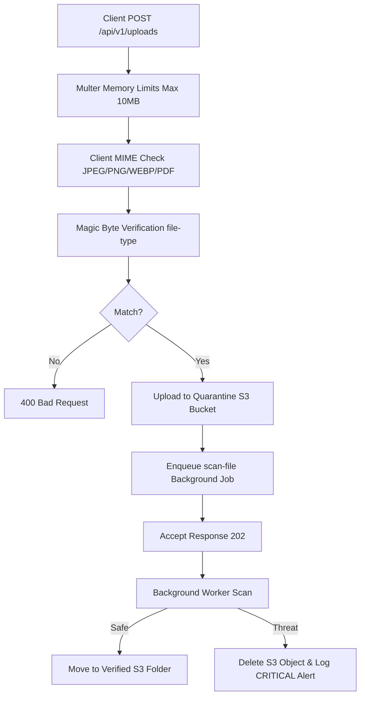

# System Architecture

## Overview

This document outlines the architecture for the production-grade RBAC platform, designed with enterprise engineering standards.

## Technical Stack

**Frontend:** Next.js App Router, TypeScript (Strict), ShadCN, RTK Query, React Hook Form, Zod  
**Backend:** Express.js, TypeScript (Strict), PostgreSQL + Prisma ORM (v7), JWT, Zod, Pino, OpenAPI

## Module Map

```
src/modules/
├── auth/           # JWT auth, register, login, refresh, logout, /me
├── users/          # User CRUD, role assignment, soft-delete
├── roles/          # Role CRUD, permission assignment
├── permissions/    # Permission CRUD
├── audit/          # Immutable audit log read-only API
└── feature-flags/  # Feature flag management (enable/disable with rollout %)
```

## Advanced Backend Patterns

### 1. Environment Validation (Config Module) [Implemented]

The application relies on a centralized `config` module (`src/config/index.ts`) that validates `process.env` strictly using Zod on startup, throwing immediately if misconfigured. It enforces environment-specific constraints, such as requiring 32+ character secrets and an `ALLOWED_ORIGINS` configuration in `production`.

### 2. High-Performance Rate Limiting & Session State [Implemented]

The platform leverages **Redis** (`ioredis`) for scalable, cross-pod rate limiting via `rate-limit-redis`. This ensures strict adherence to brute-force protections across horizontally scaled instances. Redis is also the store for distributed session invalidation (blacklisting access tokens before they expire).

### 3. Transaction-Safe DB Operations [Implemented]

Mutations that affect multiple tables (e.g., creating a User and assigning default Roles) are wrapped in a Prisma transaction (`prisma.$transaction(async (tx) => { ... })`). The transaction client `tx` is passed down to all sub-operations to guarantee atomicity.

### 4. Idempotent APIs [Implemented]

Where necessary (e.g., assigning a role to a user), endpoints are idempotent. Repeating the request safely returns success without creating duplicate database relationships, using Prisma's `connectOrCreate` or `upsert` patterns.

### 5. Driver Adapter Architecture (Prisma 7) [Implemented]

The project uses Prisma v7 with the `@prisma/adapter-pg` driver adapter pattern. Connection configuration lives in `prisma.config.ts` (for CLI tooling) and the app connection is managed via a `pg.Pool` in `src/infrastructure/database/connection.ts`. This allows native PostgreSQL connection pooling.

### 6. Centralized ABAC Policy Engine [Implemented]

The platform features a decoupled policy engine (`src/core/security/policy.ts`) that implements Attribute-Based Access Control (ABAC) and recursive role inheritance. Permissions can carry Zod-like constraints ($eq, $in, $isSubset) that are validated dynamically against resource instances loaded at runtime.

## Future Architecture Roadmap [Planned]

The modular monolith is designed to gracefully transition into a highly distributed system. The following features represent our future vision and are **not yet implemented**.

- **Dependency Injection (DI) Friendly Structure**: Transitioning controllers to accept injected services/repositories via constructors to further decouple business logic.
- **Microservices**: Domain boundaries are enforced via Service interfaces. Extracting the `audit` or `auth` module later only requires swapping the Service implementation with an HTTP/gRPC client.
- **External IAM Integrations**: The Auth module uses Strategy patterns, ready for future SSO, SAML, and OAuth provider integrations.
- **Organization Hierarchies**: The database schema will support `tenants`, preparing for recursive/hierarchical organization structures.
- **AI Authorization Dashboard**: Logs and permission matrices are heavily structured, making it easy to plug in a future AI governance dashboard for anomaly detection and role-mining.
- **Multi-Region Deployments**: Stateless JWTs and horizontally scalable Express nodes prepare the app for global edge deployments.

---

### 7. Structured Logging — PII Redaction & CRLF Sanitization [Implemented]

The Pino logger (`src/core/logger/index.ts`) has two hardened layers:

**PII/Secret Key Redaction:** Configured via Pino's built-in `redact` option. The following field paths are automatically censored with `[REDACTED]` wherever they appear in any log object, including nested paths:

```
password, passwordHash, token, accessToken, refreshToken, cookie,
authorization, apiKey, clientSecret, creditCard, ssn, birthDate
```

**CRLF Log-Injection Prevention:** `src/core/logger/sanitize.ts` exports a `sanitizeLogString(value)` utility. Any dynamic user-supplied string (header values, URL segments, IP addresses, etc.) must pass through this function before being included in a log message. It strips `\r`, `\n`, and all non-printable C0 ASCII control characters (CWE-117).

```typescript
import { sanitizeLogString } from '@core/logger/index';

logger.info({ ip: sanitizeLogString(req.ip) }, 'Request received');
```

---

### 8. Prometheus Metrics [Implemented]

A centralized `prom-client` registry (`src/core/metrics/index.ts`) exports all metric instruments. Metrics are exposed on `GET /metrics` in Prometheus text format.

| Metric | Type | Labels |
|---|---|---|
| `http_requests_total` | Counter | `method`, `path`, `status` |
| `http_request_duration_seconds` | Histogram | `method`, `path`, `status` |
| `db_query_duration_seconds` | Histogram | — |
| `active_database_connections` | Gauge | — |
| `background_jobs_processed_total` | Counter | `status`, `jobName` |
| `circuit_breaker_state` | Gauge | `name` |

**`/metrics` Endpoint Security:**

- In `production`, requests must include an `Authorization: Bearer <METRICS_TOKEN>` header.
- In `development`/`test`, the endpoint is open (no auth required).
- Set `METRICS_TOKEN` in your environment to enable production protection.

**HTTP Metrics Collection:** An Express middleware runs on every response (`res.on('finish')`) to observe `http_request_duration_seconds` and increment `http_requests_total`. Path segments matching UUIDs or numeric IDs are normalised to `/:id` to prevent high-cardinality label explosion.

**Database Pool Gauge:** `connectDatabase()` starts a `setInterval` (5 seconds, `.unref()` so it won't block process exit) that reads `pg.Pool.totalCount` and updates `active_database_connections`.

---

### 9. OpenTelemetry Distributed Tracing [Implemented]

The platform is fully instrumented with OpenTelemetry via the Node.js SDK (`@opentelemetry/sdk-node`).

**Bootstrap:** `src/tracing.ts` must be the **first import** in `src/server.ts`. This is a Node.js requirement — OTel auto-instrumentation patches modules at `require()` time, so the SDK must start before any other modules are loaded.

**Auto-Instrumented Libraries:**

| Library | Spans Generated |
|---|---|
| Express | Per-route HTTP spans |
| `pg` / `@prisma/adapter-pg` | Per-query DB spans |
| `ioredis` | Per-command Redis spans |
| `http`/`https` | Outbound HTTP request spans |
| `fs` | Disabled (too noisy) |

**Trace Export:** Spans are exported via OTLP HTTP to `OTEL_EXPORTER_OTLP_ENDPOINT/v1/traces` (default: `http://localhost:4318`). Compatible with Jaeger, Grafana Tempo, and any OTLP collector. If the collector is unreachable, spans are silently dropped.

**BullMQ Span Context Propagation:** When enqueuing a job from an HTTP handler, inject the current trace context into `job.data._tracing`:

```typescript
import { context, propagation } from '@opentelemetry/api';

const carrier: Record<string, string> = {};
propagation.inject(context.active(), carrier);
await queue.add('my-job', { ...payload, _tracing: carrier });
```

The worker (`src/infrastructure/queue/worker.ts`) extracts and restores this context using `propagation.extract()`, creating each job's span as a child of the originating HTTP span. This makes the full execution chain (HTTP → Queue → Worker → DB) visible as a single distributed trace.

**`RequestContext` with `spanId`:** `src/core/context/index.ts` reads the active OTel span's `spanId` via `trace.getActiveSpan()?.spanContext()` and stores it in the `AsyncLocalStorage` context, making it available for structured log enrichment alongside `traceId`.

---

### 10. New Environment Variables (Task 5 & 6)

| Variable | Required | Default | Description |
|---|---|---|---|
| `OTEL_EXPORTER_OTLP_ENDPOINT` | No | `http://localhost:4318` | OTLP collector endpoint for trace export |
| `METRICS_TOKEN` | Production only | — | Bearer token for `/metrics` endpoint in production |
| `AWS_S3_BUCKET` | Uploads only | `rbac-uploads-quarantine` | Secure quarantine S3 bucket |
| `UPLOAD_MAX_BYTES` | No | `10485760` | Max file upload size in bytes (10MB) |
| `CLAMAV_ENABLED` | No | `false` | Enable background ClamAV scanning worker |

---

### 11. Impossible Travel Threat Detection [Implemented]

A velocity-based geolocation threat detection evaluates successful logins against preceding login records (`src/core/security/travel.ts`).

**Algorithm:**
1. Resolves the login IP's ISO country code and geographic coordinates `[latitude, longitude]`.
2. Computes the geodesic distance in kilometers between the current and last login coordinates using the **Haversine formula**:
   $$d = 2R \arcsin\left(\sqrt{\sin^2\left(\frac{\Delta\phi}{2}\right) + \cos(\phi_1)\cos(\phi_2)\sin^2\left(\frac{\Delta\lambda}{2}\right)}\right)$$
3. Computes required travel velocity: $v = \text{distance} / \text{time elapsed}$.
4. If required velocity exceeds **800 km/h** and crosses a country boundary, triggers an active security threat.

**Response Mechanism:**
- Logs a `CRITICAL` severity audit entry (`entity: 'auth'`, `action: 'security.impossible_travel'`).
- Sets a Redis key `impossible_travel:<userId>` with a 24-hour TTL (falls back to a synchronized in-memory set in stateless test configurations).
- Token refresh requests matching suspended sessions are rejected with a `401 Unauthorized` exception: `Session suspended: unusual login location detected. Please verify your identity.`

**IP Geolocation Strategy:**
The project implements the `geoip-lite` library. It loads a local MaxMind GeoLite2 country database at startup. This enables fast, zero-network IP-to-country resolving which is 100% deterministic in test suites (by mapping mock public IP addresses).
To replace this for custom enterprise database licenses (like MaxMind GeoIP2 Precision or ipinfo.io web service), simply swap the implementation inside `src/core/security/travel.ts`'s `resolveCountry()` function.

---

### 12. Security Header Hardening [Implemented]

Explicit Helmet configuration Hardens the HTTP response headers against clickjacking, MIME-sniffing, XSS, and content framing vectors:

- **Strict CSP:** Enforces `default-src 'self'` and `script-src 'self'`. Disallows inline scripts, unsafe eval, or arbitrary scripts. (Allows `'unsafe-inline'` styles solely for Swagger UI styling block).
- **HSTS Preload:** Enforces `Strict-Transport-Security: max-age=63072000; includeSubDomains; preload` forcing TLS connections for 2 years across all subdomains.
- **Referrer Policy:** Enforces `no-referrer-when-downgrade` preventing referrers leaking down to insecure HTTP origins.

---

### 13. Secure File Upload Pipeline [Implemented]

A secure file ingestion pipeline protects the server from remote code execution (RCE) and disguised web shell injections:



1. **Size check:** Multer memorizes and rejects buffers exceeding 10MB.
2. **Signature assertion:** Resolves true binary signature (Magic Bytes) via `fileTypeFromBuffer`. Rejects spoofed extensions (e.g. text shells renamed to `.png`).
3. **Storage isolation:** Saves files with a `quarantine/` key prefix in S3 (ACL: private). Falls back to isolated `/uploads/quarantine` in local filesystem if AWS credentials are not set.
4. **Asynchronous scan:** Worker pulls `scan-file` job, executes ClamAV/threat validation, and promotions/deletes objects.


