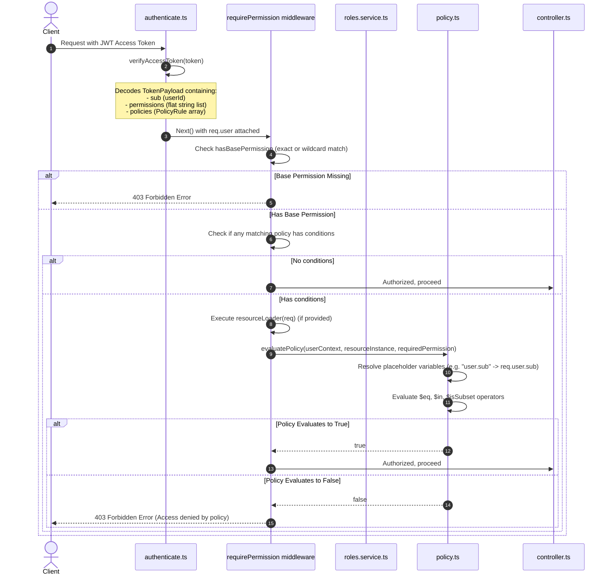

# Permission Strategy

## Nomenclature [Implemented]

Permissions are structured using a dot-notation format to guarantee uniqueness, clarity, and wildcard compatibility.

**Format:** `resource.action` (the legacy `resource:action` form is no longer used)

### Examples

- `user.read`
- `role.assign_permission`
- `feature_flags.read`

The full list lives in `src/core/security/rbac.ts`; see `RBAC_RULES.md` for how to add one.

---

## Hierarchical Role-Based Access Control (RBAC) [Implemented]

Roles support a hierarchical structure via a self-referencing `parent_id` (foreign key pointing to another `Role` record).

- When permissions are evaluated for a user, the system recursively traverses the role hierarchy tree starting from all of the user's directly assigned roles.
- The permissions and ABAC policies of parent roles are inherited automatically.
- Cycles are prevented in the application layer: the `roles.service.ts` updates check for cycles before updating `parent_id` and throw a `ValidationError` ("Role inheritance cycle detected") if a cycle is found.

---

## Attribute-Based Access Control (ABAC) & Policy Engine [Implemented]

Permissions can have conditional rules (policies) attached to them. These conditions are defined as JSON structures stored in the `RolePermission` association table under the `conditions` column.

### Policy Rule Structure

The condition block supports comparing fields from the resource instance against constants or values dynamically resolved from the `userContext` (e.g. `user.sub`, `user.email`, `user.roles`).

```typescript
export interface PolicyRule {
  action: string;
  subject: string;
  conditions?: {
    [field: string]: {
      $eq?: unknown;
      $in?: unknown[];
      $isSubset?: unknown[];
    };
  };
}
```

### Supported Operators

- `$eq`: Checks if the resource field's value matches the resolved context value (e.g. `ownerId` matches `user.sub`).
- `$in`: Checks if the resource field's value is contained in the resolved context array.
- `$isSubset`: Checks if all elements of the resource field array are subset of the resolved context array (e.g. `departments` belongs to a subset of user's allowed departments).

---

## Centralized Policy Evaluator (`evaluatePolicy`) [Implemented]

Located in [policy.ts](file:///Users/imin/Projects/RBAC_standard/backend%20copy/src/core/security/policy.ts), this decoupled engine matches the incoming resource/action with the user's policies. If any of the user's matching policies evaluate to true (conditions met), the action is authorized.

---

## Developer Execution Trace ("Stacktrace" of the Auth Flow)

For developers looking to debug or understand the authorization pipeline, here is the chronological flow of execution when a request hits a protected endpoint (e.g., `GET /api/v1/documents/:id`):



### Call Flow Reference Table

For auditing code, these are the core functions executed along the execution path:

| Order | Module/Path              | File / Symbol                                                                                                                 | Description                                                                                                                                                        |
| ----- | ------------------------ | ----------------------------------------------------------------------------------------------------------------------------- | ------------------------------------------------------------------------------------------------------------------------------------------------------------------ |
| **1** | Authentication           | [authenticate.ts:authenticate](file:///Users/imin/Projects/RBAC_standard/backend%20copy/src/middleware/authenticate.ts)       | Verifies the access token cookie or header, parses the JWT, and attaches the payload to `req.user`.                                                                |
| **2** | Authorization Guard      | [authenticate.ts:requirePermission](file:///Users/imin/Projects/RBAC_standard/backend%20copy/src/middleware/authenticate.ts)  | Guard middleware checking if the user holds the required permission name and evaluating ABAC policies dynamically.                                                 |
| **3** | Dynamic Resource Loading | _Route definitions_                                                                                                           | Passes an optional `resourceLoader` function (e.g. `(req) => ({ ownerId: req.params.ownerId })`) to `requirePermission` to retrieve runtime parameters.            |
| **4** | Policy Evaluation        | [policy.ts:evaluatePolicy](file:///Users/imin/Projects/RBAC_standard/backend%20copy/src/core/security/policy.ts)              | Matches permissions, parses target/action, resolves `user.*` prefixes, and evaluates the conditional expression blocks.                                            |
| **5** | Token Issuance           | [auth.service.ts:\_issueTokenPair](file:///Users/imin/Projects/RBAC_standard/backend%20copy/src/modules/auth/auth.service.ts) | Uses `resolvePermissionsForRoles` and `resolvePoliciesForRoles` to bundle the inherited permissions and policies of the user's role hierarchy into the issued JWT. |
